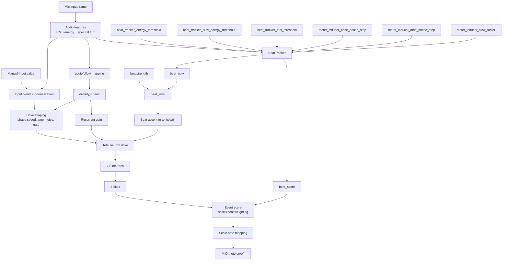

# HierarchicalLIFRhythmInterpreter

This project is a Norse-based rhythmic MIDI generator built around a small recurrent LIF network.

Current main script: `LIFMIDI.py`.

## What it does

- creates a 16-neuron LIF network (`norse.torch.LIFCell`)
- uses mixed excitatory/inhibitory recurrent connections
- drives the network with oscillatory + stochastic input
- emits MIDI note on/off events when neurons spike
- supports live control for rhythm density, chaos, and musical scale
- supports audio-reactive control where input audio drives density/stochasticity

## Requirements

- Python 3.10 or 3.11 recommended
- `torch`
- `norse`
- `numpy`
- `python-rtmidi` (or compatible `rtmidi` binding)

Install example:

```bash
pip install torch norse numpy python-rtmidi
```

## Running

```bash
python3 LIFMIDI.py
```

Optional: force a MIDI output by name match:

```bash
LIFNN_MIDI_PORT=IAC python3 LIFMIDI.py
```

On startup, the script prints available MIDI output ports and opens one.

## Interactive commands

- `auto` or blank line
- `auto N`
- `density X`
- `chaos X`
- `knobs D C`
- `beatstrength X`
- `eventthreshold X`
- `eventweights S B`
- `eventrandomness X`
- `audiofollow on|off [mix]`
- `scale NAME`
- `scale NAME ROOT`
- `beat_tracker_energy_threshold X`
- `beat_tracker_prev_energy_threshold X`
- `beat_tracker_flux_threshold X`
- `beat_tracker_sensitivity X`
- `beat_tracker_meter_weight X`
- `beat_tracker_energy_weight X`
- `beat_tracker_flux_weight X`
- `beat_tracker_trigger_threshold X`
- `meter_inducer_base_phase_step X`
- `meter_inducer_mod_phase_step X`
- `meter_inducer_slow_factor X`
- `scales`
- `show`
- `q` / `quit` / `exit`

You can also type a plain numeric value (for example `1.2`) to provide manual control input for one update step.

## Processing chain (Mermaid)



## CLI parameter reference (usage, sensible values, chain effect)

### `density`

- Usage: `density X`
- Range: `0.0..1.0`
- Sensible values:
  - `0.35-0.50`: sparse, slower pulse openings
  - `0.50-0.70`: balanced groove
  - `0.70-0.85`: denser rhythms
- Processing-chain effect:
  - increases rhythmic gate duty cycle
  - increases tonic/base excitation
  - increases pulse probability in auto mode
  - slightly increases oscillation speed/amplitude coupling

### `chaos`

- Usage: `chaos X`
- Range: `0.0..1.0`
- Sensible values:
  - `0.15-0.30`: stable and repeatable
  - `0.30-0.55`: lively and evolving
  - `0.55-0.85`: noisy/glitchy
- Processing-chain effect:
  - increases stochastic noise injected into neuron drive
  - increases recurrent variability/intensity
  - increases auto-input drift and random pulse magnitude

### `knobs`

- Usage: `knobs D C`
- Example: `knobs 0.60 0.45`
- Sensible values:
  - start with `0.55 0.35`, then tweak one axis at a time
- Processing-chain effect:
  - shorthand that sets `density` and `chaos` together
  - immediately reshapes gate behavior, noise level, and recurrent feel

### `beatstrength`

- Usage: `beatstrength X`
- Range: `0.0..2.0`
- Sensible values:
  - `0.0`: disable beat accents
  - `0.6-1.1`: musical accents (recommended)
  - `1.2-1.8`: aggressive accents/pumping
- Processing-chain effect:
  - scales `beat_level` from beat detections
  - adds accent to tonic drive and global drive multiplier on beat hits
  - stronger values produce more spike bursts near detected transients

### `eventthreshold`

- Usage: `eventthreshold X`
- Range: `0.0..1.0`
- Sensible values:
  - `0.45-0.55`: dense triggering
  - `0.55-0.70`: balanced (recommended)
  - `0.70-0.85`: sparse/selective
- Processing-chain effect:
  - threshold applied to `(event_score + stochastic_term)` before note trigger
  - higher values require stronger spike/beat evidence

### `eventweights`

- Usage: `eventweights S B`
- Range: each weight `0.0..1.0`
- Sensible values:
  - spike-led: `eventweights 0.75 0.25`
  - balanced: `eventweights 0.65 0.35`
  - beat-led: `eventweights 0.45 0.55`
- Processing-chain effect:
  - mixes neuron spike amplitude (`spike_score`) and beat influence (`beat_level`) into `event_score`
  - controls whether MIDI triggering follows neuron state or beat structure more strongly

### `eventrandomness`

- Usage: `eventrandomness X`
- Range: `0.0..1.0`
- Sensible values:
  - `0.00-0.10`: tight deterministic
  - `0.10-0.30`: musical humanization
  - `0.30-0.60`: glitch/probabilistic texture
- Processing-chain effect:
  - adds stochastic term to event decision
  - increases probabilistic variation around threshold boundary

### `audiofollow`

- Usage: `audiofollow on|off [mix]`
- `mix` range: `0.0..1.0`
- Sensible values:
  - `audiofollow on 0.30`: subtle reaction
  - `audiofollow on 0.60`: balanced reactive control
  - `audiofollow on 0.80`: strong mic-driven modulation
- Processing-chain effect:
  - maps audio RMS energy -> density target
  - maps audio spectral flux -> chaos target
  - applies smoothing and blend by `mix`
  - with `off`, density/chaos stay manual

### `beat_tracker_energy_threshold`

- Usage: `beat_tracker_energy_threshold X`
- Sensible values:
  - `0.35-0.50`: easier beat triggering
  - `0.50-0.65`: default-ish behavior
  - `0.65-0.85`: stricter triggering
- Processing-chain effect:
  - threshold in BeatTracker for audio energy gate
  - lower values produce more beat events

### `beat_tracker_prev_energy_threshold`

- Usage: `beat_tracker_prev_energy_threshold X`
- Sensible values:
  - `0.35-0.50`: allows beats to retrigger sooner
  - `0.50-0.65`: balanced retrigger behavior
  - `0.65-0.85`: fewer retriggers
- Processing-chain effect:
  - previous-energy condition for beat edge detection
  - changes how quickly consecutive beats can fire

### `beat_tracker_flux_threshold`

- Usage: `beat_tracker_flux_threshold X`
- Sensible values:
  - `0.15-0.25`: catches more transients
  - `0.25-0.40`: balanced
  - `0.40-0.70`: only strong transients
- Processing-chain effect:
  - threshold for spectral-flux gate in beat detection
  - lower values increase sensitivity to timbral changes

### `beat_tracker_sensitivity`

- Usage: `beat_tracker_sensitivity X`
- Note: this parameter is exposed in CLI but currently not used by beat logic in code.
- Sensible values:
  - keep near `1.0` until logic is wired to consume it
- Processing-chain effect:
  - currently no direct effect on processing chain (placeholder control)

### `beat_tracker_meter_weight`

- Usage: `beat_tracker_meter_weight X`
- Range: `0.0..1.0`
- Sensible values:
  - `0.35-0.55` for balanced meter influence
- Processing-chain effect:
  - weight for hypothesis meter strength in beat-score fusion

### `beat_tracker_energy_weight`

- Usage: `beat_tracker_energy_weight X`
- Range: `0.0..1.0`
- Sensible values:
  - `0.20-0.40`
- Processing-chain effect:
  - weight for audio energy score in beat-score fusion

### `beat_tracker_flux_weight`

- Usage: `beat_tracker_flux_weight X`
- Range: `0.0..1.0`
- Sensible values:
  - `0.15-0.35`
- Processing-chain effect:
  - weight for spectral flux score in beat-score fusion

### `beat_tracker_trigger_threshold`

- Usage: `beat_tracker_trigger_threshold X`
- Range: `0.0..1.0`
- Sensible values:
  - `0.45-0.60` usually musical
- Processing-chain effect:
  - threshold for converting beat score to boolean beat event
  - lower values create more beat events; higher values make beats stricter

### `meter_inducer_base_phase_step`

- Usage: `meter_inducer_base_phase_step X`
- Sensible values:
  - `0.40-0.55`: slower beat-cycle stepping
  - `0.55-0.75`: balanced
  - `0.75-1.10`: faster cycle stepping
- Processing-chain effect:
  - controls meter-inducer phase increment per update
  - influences when BeatTracker allows beat pulses (`is_one`)

### `meter_inducer_mod_phase_step`

- Usage: `meter_inducer_mod_phase_step X`
- Sensible values:
  - `0.04-0.07`: gentler modulation
  - `0.07-0.12`: stronger modulation cadence
- Processing-chain effect:
  - changes meter inducer modulation-rate progression
  - affects rhythmic mask timing in beat admission

### `meter_inducer_slow_factor`

- Usage: `meter_inducer_slow_factor X`
- Sensible values:
  - `0.40-0.60`: fewer beat-admission checks
  - `0.70-0.90`: frequent checks (default-ish around `0.8`)
  - avoid `>= 1.0` to prevent unstable step interval behavior
- Processing-chain effect:
  - sets cadence of meter-inducer gating checks (`step_index % int(1/slow_factor)`)
  - higher values generally allow beat checks more often

### `scale`

- Usage: `scale NAME` or `scale NAME ROOT`
- `ROOT` range: `0..127` (MIDI note number)
- Sensible values:
  - melodic: `scale minor_pentatonic 36`, `scale lydian 48`
  - drum mode: `scale drums` (GM kit on MIDI channel 10)
- Processing-chain effect:
  - remaps spike indices to MIDI notes
  - in `drums`, switches to GM percussion note layout and drum channel

### `auto`

- Usage: `auto` or `auto N`
- `N` sensible values:
  - `64-128`: quick test
  - `256-512`: phrase-length exploration
  - `1024+`: long generative run
- Processing-chain effect:
  - feeds the network with an internal stochastic control signal
  - control signal drift/pulses are shaped by `chaos` and `density`

## Scale support

Built-in scale names:

- `major`
- `minor`
- `harmonic_minor`
- `melodic_minor`
- `major_pentatonic`
- `minor_pentatonic`
- `blues`
- `dorian`
- `phrygian`
- `lydian`
- `mixolydian`
- `locrian`
- `whole_tone`
- `chromatic`
- `drums` (GM drum mapping on MIDI channel 10)

## Model behavior notes

- Very large manual inputs are compressed internally (`tanh`) to keep dynamics stable.
- The network has rhythmic gating, slow modulation, and anti-silence recovery to avoid dead states.
- Beat detection from audio transients can inject accents into the drive stage.
- Meter hypotheses are now adaptively switched by the meter agent when beats are not confirmed for several steps.

## Quick starting presets

- Stable groove: `knobs 0.45 0.20`
- Evolving rhythm: `knobs 0.60 0.45`
- Glitchier texture: `knobs 0.75 0.80`
- Minor pentatonic bass area: `scale minor_pentatonic 36`
- Brighter modal feel: `scale lydian 48`
- GM percussion kit: `scale drums`

## Live performance cheat sheet

Use these as quick command sequences during live tweaking.

### Scene 1: Tight groove (safe start)

```text
scale minor_pentatonic 36
knobs 0.48 0.22
beatstrength 0.75
audiofollow on 0.35
auto 256
```

### Scene 2: Musical evolution (balanced)

```text
scale dorian 38
knobs 0.60 0.45
beatstrength 1.00
eventthreshold 0.58
eventweights 0.65 0.35
eventrandomness 0.10
audiofollow on 0.60
auto 384
```

### Scene 3: Drum-forward reactive jam

```text
scale drums
knobs 0.68 0.40
beatstrength 1.20
eventthreshold 0.56
eventweights 0.60 0.40
eventrandomness 0.16
audiofollow on 0.70
auto 512
```

### Scene 3b: Drum jam + tighter beat detector

```text
scale drums
knobs 0.66 0.42
beatstrength 1.10
eventthreshold 0.57
eventweights 0.58 0.42
eventrandomness 0.14
beat_tracker_energy_threshold 0.58
beat_tracker_flux_threshold 0.34
beat_tracker_meter_weight 0.50
beat_tracker_energy_weight 0.30
beat_tracker_flux_weight 0.20
beat_tracker_trigger_threshold 0.55
meter_inducer_base_phase_step 0.62
meter_inducer_mod_phase_step 0.08
meter_inducer_slow_factor 0.80
audiofollow on 0.70
auto 512
```

### Scene 4: Glitch burst

```text
scale whole_tone 48
knobs 0.78 0.82
beatstrength 1.55
audiofollow on 0.80
auto 192
```

### Scene 5: Ambient sparse texture

```text
scale lydian 50
knobs 0.35 0.18
beatstrength 0.45
audiofollow on 0.25
auto 512
```

### Fast rescue moves (if sound is too chaotic or too static)

- Too chaotic/noisy:
  - `chaos 0.25`
  - `density 0.50`
  - `beatstrength 0.80`
- Too static/boring:
  - `chaos 0.55`
  - `density 0.65`
  - `beatstrength 1.20`
- Mic influence too strong/weak:
  - strong: `audiofollow on 0.75`
  - subtle: `audiofollow on 0.30`
  - off: `audiofollow off`

## Notes

- If you see no sound, verify your MIDI routing (DAW/synth input) and selected output port.
- The script emits MIDI events only; external synth/sampler/DAW must render audio.
